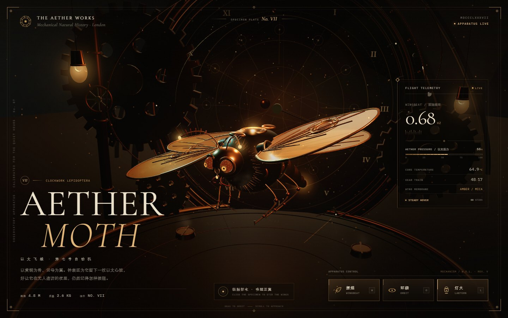

<div align="center">

# AETHER MOTH · 以太飞蛾

**第七号自动机 / Clockwork Lepidoptera**

蒸汽朋克天文钟观测厅中的互动机械飞蛾。黄铜骨架、琥珀云母翼膜、巨型星象钟盘与实时振翅遥测。

[在线预览](https://gemcodexstar.github.io/aether-moth/) · Three.js · WebGL



</div>

## 特性

- **以太飞蛾**：程序化黄铜骨架、复眼、绒毛、云母翼膜与鳞片纹理，带有非对称振翅相位、二次谐波与惯性俯仰。
- **天文钟观测厅**：巨型星象钟表窗、黄铜拱券、倾斜浑天环、星空、悬挂提灯与地面钟盘反照。
- **实时交互**：点击飞蛾或按钮触发振翅、自动环绕视角、提灯氛围光与飞行遥测。
- **渲染稳定性**：直接 WebGL 渲染；静态部件按材质合批（约 620 → 390 draw calls）；5 盏实时光源。已移除会触发黑色合成块的 UnrealBloom 后处理链，并保留 WebGL 上下文丢失恢复层。

## 操作

| 操作 | 效果 |
| --- | --- |
| 点击飞蛾 / `W` | 触发一次强力振翅 |
| `O` / 环绕按钮 | 开关自动环绕 |
| `L` / 灯火按钮 | 开关提灯氛围光 |
| 拖拽 | 手动旋转视角 |
| 滚轮 | 缩放 |

## 本地运行

```bash
npm install
npm run build
# 直接打开 index.html
```

## 结构

- `index.html` / `aether.css` / `aether.js` — 可直接部署的静态页面
- `src/aether/` — Three.js 场景源码
- `preview.jpg` — 页面预览

构建脚本使用 esbuild 将 Three.js 与场景源码打包为单文件 `aether.js`。
